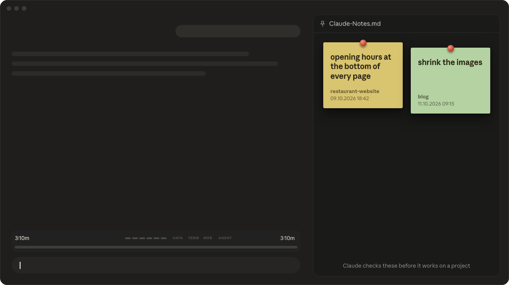

🇩🇪 [Deutsch](README.de.md)

# nix note

**Project notes on the side – type `/note`, done. Claude knows them and applies them.**



## The problem

While Claude works, something occurs to you: "bigger logo", "check that colour again". Write it in the chat and you interrupt Claude, or it gets lost in the history. A week later you don't remember which project it belonged to.

## The solution

`/note` saves a note with date, project and chat into one file – without interrupting Claude. And Claude knows your notes: before it works on a project, it checks that project's notes and applies them.

## Install

1. Open Claude Code (desktop app or terminal).
2. Type this into the message box and press Enter:
   ```
   /plugin marketplace add nikscz/nix-note
   ```
3. Then:
   ```
   /plugin install nix-note@nix-note
   ```
4. Restart Claude Code once (or type `/reload-plugins`). Done.

No GitHub account needed.

## How to

```
/note make the logo bigger
```

- The note lands in **Documents/Claude-Notes.md** (German system: **Claude-Notizen.md**) – even
  while Claude is working.
- Each note gets automatically: date and time, project and folder, Git repository (if any),
  what the chat was about, and the chat ID.
- **Claude applies them:** before building or changing something in a project, Claude looks for
  that project's notes and takes them into account. If a note is outside the current task,
  Claude asks first.
- **Ask about them:** *"What did I note about the logo?"* – Claude finds the notes and tells you
  which project and chat they came from.
- One file for everything, open it with any text editor.

| Command | What happens |
|---|---|
| `/note your text` | saves the note |

## Privacy & security

Everything stays on your computer:

| Reads | Stores |
|---|---|
| Your last message to Claude (for "In the chat") | only when you type `/note`: its first 140 characters, in your notes file |
| Project folder, Git repository name, chat ID | only when you type `/note`: in your notes file |
| Your notes file, when Claude looks up notes | the note, in **Documents/Claude-Notes.md** (German system: Claude-Notizen.md) – nowhere else |

**Sends nothing anywhere.** No internet connection, no tracking, no analytics. The code is open –
you can check it yourself.

**Language check:** so the labels show up in your language, it reads your system language once per chat
with one harmless system command – `defaults read -g AppleLanguages` on a Mac,
`(Get-Culture).TwoLetterISOLanguageName` in PowerShell on Windows. Nothing else is read.

> [!WARNING]
> **Early version – updates will come.** This kind of extension is still brand new in Claude Code.
> After an update from Anthropic something may stop working until a fix lands here.
> With automatic updates on (below) you get the fix by itself.

## Updates

Turn it on once and forget it: type `/plugin` → **Marketplaces** → **nix-note** → turn on
automatic updates.

Or by hand, whenever you like:
```
/plugin marketplace update nix-note
```

### What's new

**2.2 – German and English.** The tool's own labels now follow your system language: German
on a German system, English everywhere else. Other languages (e.g. Spanish) get the English labels –
but everything Claude writes itself (the steps, the thank-you, its answers) comes in your language
anyway.

## Uninstall

```
/plugin uninstall nix-note@nix-note
```

## More from nikscz

- [nix-checklist-sidebar](https://github.com/nikscz/nix-checklist-sidebar) – Claude's plan as a checklist
- [nix-progress-bar](https://github.com/nikscz/nix-progress-bar) – progress bar with a time estimate
- [nix-done-sound](https://github.com/nikscz/nix-done-sound) – your own alert sound when Claude is done

## License

[MIT](LICENSE) – use it, change it, pass it on, no warranty.

Made with Claudius, for Claudius. Found a bug or have an idea?
Open an [issue](https://github.com/nikscz/nix-note/issues).
